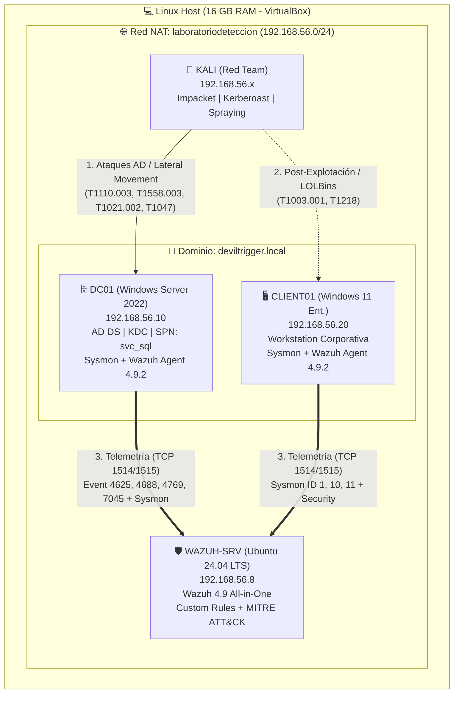

## 🚨 Playbooks de Respuesta a Incidentes (SOP) y Hardening

Cada detección desarrollada en el laboratorio cuenta con su procedimiento operativo estándar (SOP) para analistas SOC N1/N2, detallando las fases de **Triaje, Threat Hunting, Contención y Hardening de Active Directory**:

- 📄 **[PB-01: Respuesta ante Kerberoasting y Compromiso de Cuentas de Servicio (T1558.003)](./playbooks/PB-01-Kerberoasting.md)**
- 📄 **[PB-02: Respuesta ante Movimiento Lateral Remoto vía PsExec y WMI (T1021.002 / T1047)](./playbooks/PB-02-Movimiento-Lateral.md)**
